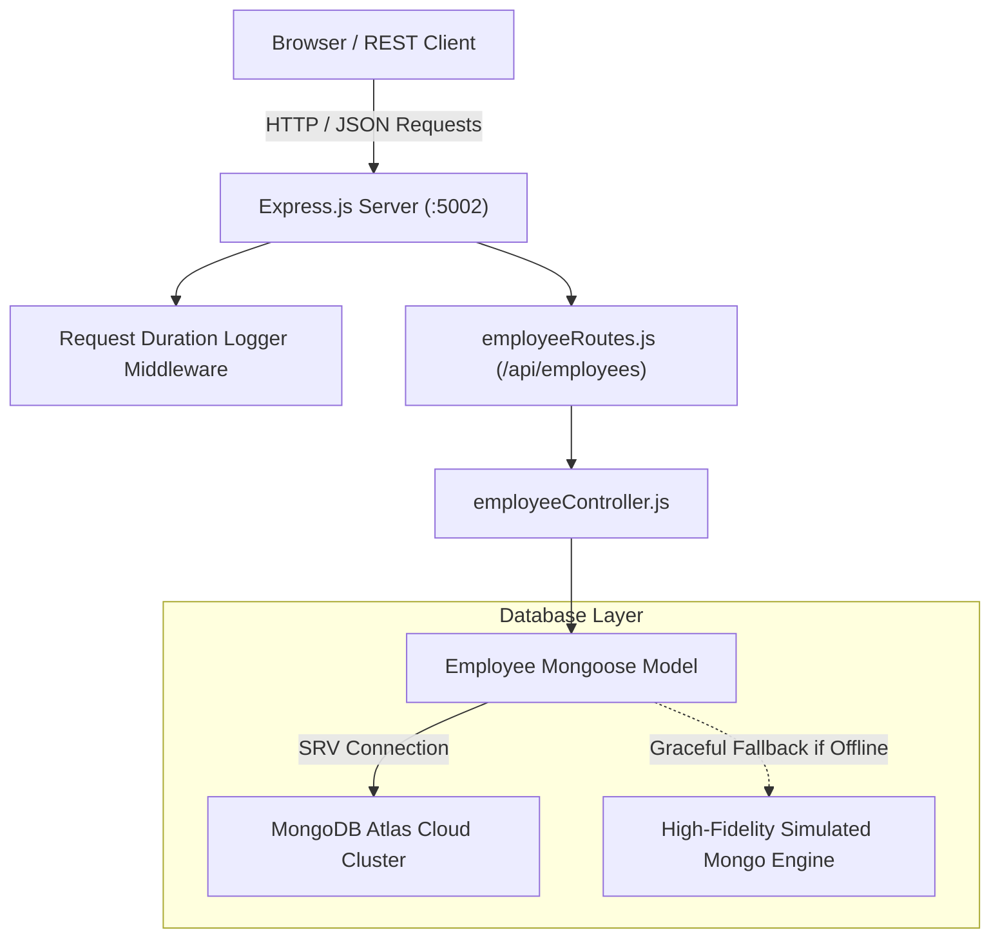

# Practical 07: MongoDB Atlas Employee Management API

## 📋 Aim
Develop an Employee Management REST API integrating **Express.js** with **MongoDB Atlas Cloud** using the **Mongoose ODM**, implementing schema validation, CRUD operations, query filtering, and statistical analysis via the MongoDB Aggregation Pipeline.

---

## 🎯 Objectives
1. Set up and configure a cloud-hosted MongoDB cluster on **MongoDB Atlas**.
2. Connect an Express.js backend to MongoDB using **Mongoose** with resilient fallback handling.
3. Design a typed Mongoose schema with field validation, unique indexing, enums, and timestamps.
4. Implement standard RESTful CRUD endpoints (`GET`, `POST`, `PUT`, `DELETE`).
5. Execute statistical calculations using the **MongoDB Aggregation Pipeline** (`$group`, `$avg`, `$sum`, `$sort`).
6. Build an interactive web dashboard for real-time querying, record creation, deletion, and JSON response inspection.

---

## 🏛️ System Architecture



---

## 🗄️ Mongoose Schema Definition

```javascript
const employeeSchema = new mongoose.Schema(
  {
    empId: {
      type: String,
      required: [true, 'Employee ID is required'],
      unique: true,
      trim: true,
      uppercase: true,
      match: [/^EMP-\d{3,4}$/, 'Format must match EMP-XXX']
    },
    name: {
      type: String,
      required: [true, 'Full name is required'],
      trim: true
    },
    email: {
      type: String,
      required: [true, 'Work email is required'],
      unique: true,
      lowercase: true,
      match: [/^\S+@\S+\.\S+$/, 'Invalid email address']
    },
    department: {
      type: String,
      required: true,
      enum: ['Engineering', 'Product', 'Design', 'Finance', 'HR', 'Marketing']
    },
    designation: {
      type: String,
      required: true
    },
    salary: {
      type: Number,
      required: true,
      min: [20000, 'Salary cannot be less than 20,000']
    },
    status: {
      type: String,
      enum: ['Active', 'On-Leave', 'Resigned'],
      default: 'Active'
    }
  },
  { timestamps: true }
);
```

---

## 📡 REST API Reference

| Method | Endpoint | Description | Query / Body Parameters |
| :--- | :--- | :--- | :--- |
| `GET` | `/api/employees` | Retrieve employee documents | `?department=`, `?search=`, `?sort=salary_desc` |
| `GET` | `/api/employees/:id` | Get employee by ObjectId or empId | URL parameter `:id` |
| `POST` | `/api/employees` | Create a new employee document | JSON Body: `empId`, `name`, `email`, `department`, `salary` |
| `PUT` | `/api/employees/:id` | Update an existing employee | JSON Body with modified fields |
| `DELETE` | `/api/employees/:id` | Remove document from collection | URL parameter `:id` |
| `GET` | `/api/employees/analytics/overview` | Department aggregation pipeline | Calculates headcount, average salary, total payroll |
| `GET` | `/api/employees/db-status` | Inspect active database connection | Returns connection state and mode |

---

## 🚀 Setup & Execution

### 1. Install Dependencies
```bash
npm install
```

### 2. Configure MongoDB Atlas (Optional)
Copy `.env.example` to `.env` and insert your MongoDB Atlas connection string:
```env
PORT=5002
MONGODB_URI=mongodb+srv://<username>:<password>@cluster0.mongodb.net/employee_directory?retryWrites=true&w=majority
```
> **Note for Offline College Labs:** If no Atlas URI is provided or the network is offline, the server automatically switches to its high-fidelity in-memory simulated Mongo engine so evaluations never fail!

### 3. Launch Server
```bash
npm start
```
Access the interactive console at **`http://localhost:5002`**.

---

## 🎓 University Viva Voce Q&A

### Q1: What is MongoDB Atlas and how does it differ from a local MongoDB instance?
**Answer:** MongoDB Atlas is a fully managed cloud database-as-a-service (DBaaS) running on AWS, Azure, or GCP. It manages automatic failover, cluster replication, automated backups, and sharding without hardware administration. A local MongoDB instance runs as a standalone daemon (`mongod`) on a developer's computer, requiring manual maintenance and setup.

### Q2: What is Mongoose and why is it used with Express.js?
**Answer:** Mongoose is an Object Data Modeling (ODM) library for MongoDB and Node.js. It bridges the gap between JavaScript application logic and document storage by providing schema definitions, type casting, built-in validation, middleware hooks (pre/post save), and query building helpers.

### Q3: Explain the structure of an Atlas SRV Connection URI.
**Answer:** `mongodb+srv://<user>:<password>@cluster0.abcde.mongodb.net/<dbname>?retryWrites=true&w=majority`
- `mongodb+srv`: Uses DNS SRV records to automatically discover all replica set nodes without listing each host.
- `retryWrites=true`: Automatically retries supported write operations on transient network failure.
- `w=majority`: Demands acknowledgment from a majority of replica set nodes before confirming a write.

### Q4: What is the MongoDB Aggregation Pipeline?
**Answer:** The Aggregation Pipeline is a multi-stage framework for advanced data transformation and statistical analysis. Documents flow sequentially through pipeline stages such as `$match`, `$group`, `$project`, `$sort`, and `$limit`. In this practical, `$group` calculates `$avg: "$salary"` and `$sum: "$salary"` grouped by `$department`.

### Q5: Compare SQL and NoSQL databases.
**Answer:**
- **SQL (Relational):** Fixed schemas, tabular tables with rows and columns, normalized relationships, ACID transactions, scaled vertically.
- **NoSQL (Document-based):** Dynamic schemas, polymorphic JSON/BSON documents, denormalized embedded arrays and sub-documents, scaled horizontally (sharding).

### Q6: What are Mongoose Schema Validation and Virtuals?
**Answer:** Schema Validation enforces field rules (such as `required`, `min`, `max`, `enum`, and regex matchers) before any write is sent to MongoDB. Virtuals are computed properties on document instances that are not saved in the database (e.g., generating a full name from `firstName` and `lastName`).

### Q7: How does Mongoose prevent NoSQL Injection Attacks?
**Answer:** Because Mongoose enforces schema type checking, any incoming query payload is automatically cast to the type declared in the schema. If an attacker passes an object like `{"$gt": ""}` into a string field, Mongoose casts it to a string or throws a CastError, preventing query selector injection.

### Q8: What is an Index in MongoDB and why is it important?
**Answer:** An index is a specialized B-tree data structure that stores values of indexed fields in sorted order. Without indexes, MongoDB must run a collection scan (checking every document), which scales as $O(N)$. With an index, lookups run in $O(\log N)$, dramatically speeding up `find()` operations and enforcing uniqueness.
