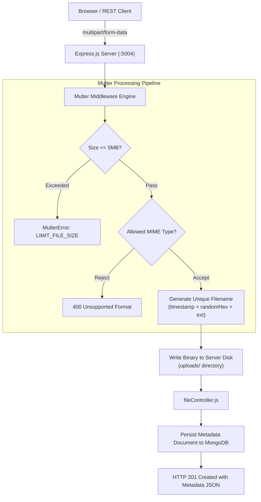

# Practical 09: Multer File Upload Module with MongoDB Metadata Storage

## 📋 Aim
Create a file upload module using **Multer** and store file metadata in **MongoDB**, implementing disk storage configuration, MIME-type validation, file size constraints, single and multiple batch file uploads, and an interactive file manager web interface.

---

## 🎯 Objectives
1. Understand `multipart/form-data` encoding and why standard body parsers cannot handle binary file streams.
2. Configure **Multer** using `multer.diskStorage` to handle storage destination and cryptographic unique file renaming.
3. Enforce **MIME-type filtering** (`fileFilter`) to accept verified document and image formats (JPEG, PNG, WEBP, GIF, PDF, TXT, DOCX) while rejecting executables.
4. Set strict file size limits (5 MB max) and handle `LIMIT_FILE_SIZE` errors cleanly.
5. Store lightweight, queryable file metadata (`originalName`, `filename`, `mimetype`, `size`, `category`, `description`) in MongoDB via Mongoose.
6. Implement single and batch uploads, file download with `Content-Disposition`, physical file deletion via `fs.unlink`, and storage statistics.

---

## 🏛️ System Architecture



---

## 🗄️ MongoDB Metadata Schema

```javascript
const fileRecordSchema = new mongoose.Schema(
  {
    originalName: { type: String, required: true, trim: true },
    filename:     { type: String, required: true, unique: true },
    path:         { type: String, required: true },
    mimetype:     { type: String, required: true },
    size:         { type: Number, required: true },
    category: {
      type: String,
      enum: ['Document', 'Image', 'Assignment', 'Lab-Report', 'Other'],
      default: 'Document'
    },
    description:  { type: String, default: 'Uploaded via Multer File Module' },
    uploader:     { type: String, default: 'Student' }
  },
  { timestamps: true }
);

// Virtual for formatted human-readable size
fileRecordSchema.virtual('formattedSize').get(function () {
  if (this.size < 1024) return `${this.size} B`;
  if (this.size < 1024 * 1024) return `${(this.size / 1024).toFixed(1)} KB`;
  return `${(this.size / (1024 * 1024)).toFixed(2)} MB`;
});
```

---

## 📡 REST API Reference

| Method | Endpoint | Description | Request Content-Type |
| :--- | :--- | :--- | :--- |
| `POST` | `/api/files/upload` | Upload single file + metadata | `multipart/form-data` (`file`, `category`, `description`) |
| `POST` | `/api/files/upload-multiple` | Upload up to 5 files | `multipart/form-data` (`files`, `category`) |
| `GET` | `/api/files` | List all files with search & category filter | `?category=`, `?search=` |
| `GET` | `/api/files/:id/download` | Download attachment file | Returns binary stream with `Content-Disposition` |
| `DELETE`| `/api/files/:id` | Remove from disk (`fs.unlink`) and delete metadata | URL parameter `:id` |
| `GET` | `/api/files/stats/storage` | Aggregate storage size & category breakdown | Returns total bytes and category counts |
| `GET` | `/api/files/db-status` | Database cluster health status | Returns Atlas or simulated fallback state |

---

## 🚀 Setup & Execution

### 1. Install Dependencies
```bash
npm install
```

### 2. Configure MongoDB Atlas (Optional)
Set your Atlas URI in `.env`:
```env
PORT=5004
MONGODB_URI=mongodb+srv://<username>:<password>@cluster0.mongodb.net/files_db?retryWrites=true&w=majority
```
> **Note for Offline College Labs:** If no Atlas URI is provided, the server operates in local fallback mode with pre-loaded mock files.

### 3. Launch Server
```bash
npm start
```
Access the interactive file manager at **`http://localhost:5004`**.

---

## 🎓 University Viva Voce Q&A

### Q1: What is Multer and why is standard Express body-parser insufficient for file uploads?
**Answer:** Multer is a Node.js middleware specifically designed for handling `multipart/form-data` encoding. Standard Express body parsers (`express.json()`, `express.urlencoded()`) parse text-based UTF-8 string bodies and cannot handle binary streams, chunked boundaries, or large file uploads.

### Q2: Compare `diskStorage` and `memoryStorage` in Multer.
**Answer:**
- **`diskStorage`:** Saves uploaded files directly to persistent disk storage (e.g. `uploads/` folder). It is ideal for large files, videos, documents, and production storage where memory usage must remain low.
- **`memoryStorage`:** Stores uploaded files in system RAM as Node.js `Buffer` objects. It is suitable for small files that will be immediately forwarded to cloud storage (like AWS S3) or transformed in memory (e.g. resizing with Sharp).

### Q3: Why should file metadata be stored in MongoDB while physical files remain on disk?
**Answer:** MongoDB documents have a 16MB document size limit (BSON specification). Storing large binary files directly inside database documents causes database bloat, exhausts RAM cache, and slows down backups. The standard architecture stores the binary file on the filesystem or an object bucket and records lightweight, indexable metadata in MongoDB for fast queries.

### Q4: How does Multer enforce File Size and File Type constraints?
**Answer:**
- **File Size:** Configured via `limits: { fileSize: 5 * 1024 * 1024 }`. When a client exceeds 5MB, Multer emits a `LIMIT_FILE_SIZE` error.
- **File Type:** Configured via `fileFilter(req, file, cb)` where `file.mimetype` is matched against an allowed whitelist. Calling `cb(new Error('Invalid type'), false)` rejects unauthorized files.

### Q5: Why is cryptographic unique filename generation essential?
**Answer:** Storing uploaded files under their original names can result in name collisions (e.g., multiple users uploading `resume.pdf`), overwriting previous files. Using timestamps and cryptographic random strings (e.g., `Date.now() + '-' + crypto.randomBytes(6).toString('hex') + ext`) ensures collision-free uniqueness.

### Q6: What is `multipart/form-data` encoding?
**Answer:** `multipart/form-data` divides the HTTP request body into multiple distinct parts, each separated by a boundary string. Each part contains headers (such as `Content-Disposition` and `Content-Type`) followed by the field value or binary payload, allowing binary files and text fields to be submitted together in one request.

### Q7: How does `res.download()` differ from `res.sendFile()`?
**Answer:** `res.sendFile()` serves the file directly for browser rendering (e.g., displaying an image inline). `res.download(filePath, originalName)` sets the HTTP header `Content-Disposition: attachment; filename="originalName"`, prompting the browser to download the file directly to the user's downloads folder.

### Q8: What security best practices must be implemented for file uploads?
**Answer:**
1. Reject executable extensions (`.exe`, `.sh`, `.php`, `.bat`).
2. Store files outside the web root directory to prevent direct code execution.
3. Validate MIME types and file headers (magic numbers).
4. Restrict maximum file size to mitigate denial-of-service (DoS) storage attacks.
