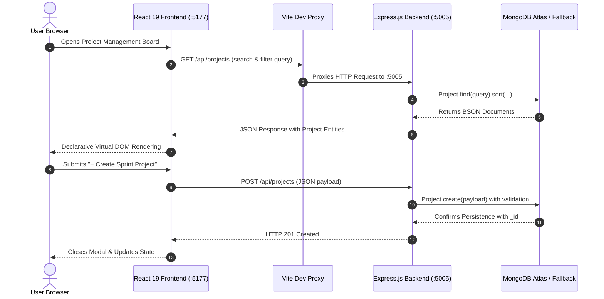

# Practical 10: Complete Full-Stack MERN Project Management Application

## 📋 Aim
Develop a complete, production-grade **MERN** (MongoDB, Express.js, React, Node.js) full-stack web application for Sprint and Project Management, integrating a responsive React 19 Single Page Application (SPA) frontend with an Express 4 RESTful backend and MongoDB Atlas cloud document database.

---

## 🎯 Objectives
1. Architect an end-to-end full-stack solution connecting **React 19**, **Express.js**, **Node.js**, and **MongoDB**.
2. Build a modern React frontend utilizing hooks (`useState`, `useEffect`, `useCallback`), controlled form modals, optimistic UI updates, and responsive CSS glassmorphism.
3. Configure a robust Express.js backend with structured controllers, route separation, request duration logging, and centralized error handling.
4. Model complex business entities using Mongoose schemas with data types, min/max limits, enums, and timestamps.
5. Solve Cross-Origin Resource Sharing (CORS) using both server-side CORS middleware and client-side Vite reverse proxying.
6. Implement full CRUD operations: create projects, fetch filtered/sorted lists, update statuses via optimistic dropdowns, and delete documents with confirmation.

---

## 🏛️ MERN Full-Stack Data Flow



---

## 📁 Repository Structure

```
Practical-10-MERN-FullStack-App/
├── package.json               # Root scripts
├── server/                    # Express.js & MongoDB Backend (Port 5005)
│   ├── package.json
│   ├── server.js              # Entry point & CORS/Logging middleware
│   ├── config/
│   │   └── db.js              # Atlas connection with offline fallback
│   ├── models/
│   │   └── Project.js         # Mongoose schema validation & enums
│   ├── controllers/
│   │   └── projectController.js # CRUD & Statistical Aggregation
│   └── routes/
│       └── projectRoutes.js   # REST API route mapping
└── client/                    # React 19 + Vite Frontend (Port 5177)
    ├── package.json
    ├── vite.config.js         # Reverse proxy to :5005
    ├── index.html
    └── src/
        ├── main.jsx           # ReactDOM entry
        ├── App.jsx            # State orchestration & filters
        ├── index.css          # Glassmorphic vanilla CSS design system
        └── components/
            ├── StatsOverview.jsx     # Top metrics banner
            ├── ProjectCard.jsx       # Individual sprint card
            ├── ProjectFormModal.jsx  # Controlled form modal
            └── VivaSection.jsx       # 8 viva voce Q&As
```

---

## 📡 Backend REST API Reference

| Method | Endpoint | Description | Query / Body Parameters |
| :--- | :--- | :--- | :--- |
| `GET` | `/api/projects` | Fetch projects with filters & search | `?search=`, `?category=`, `?status=`, `?sort=` |
| `GET` | `/api/projects/:id` | Fetch single project by ID | URL parameter `:id` |
| `POST` | `/api/projects` | Create a new sprint project | JSON Body: `title`, `lead`, `budget`, `category`, etc. |
| `PUT` | `/api/projects/:id` | Update project fields / status | JSON Body with modified properties |
| `DELETE`| `/api/projects/:id` | Delete project from database | URL parameter `:id` |
| `GET` | `/api/projects/analytics/summary`| Aggregated metrics & budget rollups | Total projects, active sprints, average progress |
| `GET` | `/api/health` | Check backend & database connection status | Returns MongoDB Atlas or local engine status |

---

## 🚀 Setup & Execution

### 1. Launch Backend Server (Port 5005)
Open a terminal in the practical directory:
```bash
cd server
npm install
npm start
```

### 2. Launch React Frontend (Port 5177)
In a second terminal:
```bash
cd client
npm install
npm run dev
```

Open **`http://localhost:5177`** in your browser. All API requests are automatically reverse-proxied to `http://localhost:5005`.

---

## 🎓 University Viva Voce Q&A

### Q1: What does the MERN stack stand for and how do its four components interact?
**Answer:** MERN stands for **M**ongoDB (NoSQL database), **E**xpress.js (Node web framework), **R**eact (frontend user interface library), and **N**ode.js (JavaScript runtime engine). The user interacts with React in the browser. React sends asynchronous HTTP/REST requests (via `fetch` or `axios`) to Express. Express processes business logic, validates inputs, and queries MongoDB via Mongoose before sending formatted JSON responses back to React for rendering.

### Q2: What is CORS and how was it solved in this MERN application?
**Answer:** Cross-Origin Resource Sharing (CORS) is a browser security mechanism that restricts resources requested from another origin. In this practical, CORS is handled in two layers:
1. **Backend:** Express mounts the `cors()` middleware to explicitly allow cross-origin requests.
2. **Frontend:** The Vite development server configures a reverse proxy in `vite.config.js` forwarding `/api/*` requests directly to `http://localhost:5005`, bypassing browser cross-origin restrictions entirely.

### Q3: What are Controlled Components in React?
**Answer:** A controlled component is an input element whose value is bound to and governed by React component state. An `onChange` handler updates state on every keystroke. In `ProjectFormModal.jsx`, each input is bound to `formData`, ensuring immediate validation, formatted inputs, and synchronization between UI and state.

### Q4: Explain Optimistic UI Updating in the context of this project.
**Answer:** Optimistic UI updates the client's local React state immediately upon user action (e.g. changing project status in the dropdown) *before* the HTTP request completes. If the server later returns an error, the state is rolled back to a previous snapshot and an alert is shown. This makes the interface feel instantaneous.

### Q5: What is the significance of the `useEffect` hook in API integration?
**Answer:** `useEffect` enables side effects in functional components. Providing an empty dependency array (`[]`) causes the effect to run exactly once after the component mounts into the DOM, making it the standard pattern for initial asynchronous data fetching from backend REST endpoints.

### Q6: How does Mongoose Schema Validation protect MongoDB data?
**Answer:** MongoDB is schema-less by design, allowing documents in the same collection to have disparate structures. Mongoose acts as an Object Data Modeling (ODM) layer enforcing data types, mandatory fields (`required: true`), numeric constraints (`min: 1000`), and enumerated sets (`enum: ['Backlog', 'In-Progress', 'Review', 'Completed']`) before writes are committed.

### Q7: Why are Environment Variables (`.env`) used across MERN stacks?
**Answer:** Environment variables separate sensitive configuration (database passwords, private keys, API secrets) from the application source code. They allow the same codebase to run seamlessly across development, staging, and production environments without hardcoded credentials.

### Q8: Compare Client-Side Rendering (CSR) with Server-Side Rendering (SSR).
**Answer:**
- **CSR (React SPA):** The server delivers a blank HTML file and a JavaScript bundle. The browser downloads the JS and renders the entire interface locally. Page transitions happen instantly without full page reloads.
- **SSR (Next.js / Express EJS):** The server generates the complete HTML document on every request before sending it to the browser. It delivers faster initial page paint and superior SEO, but incurs higher server CPU usage.
