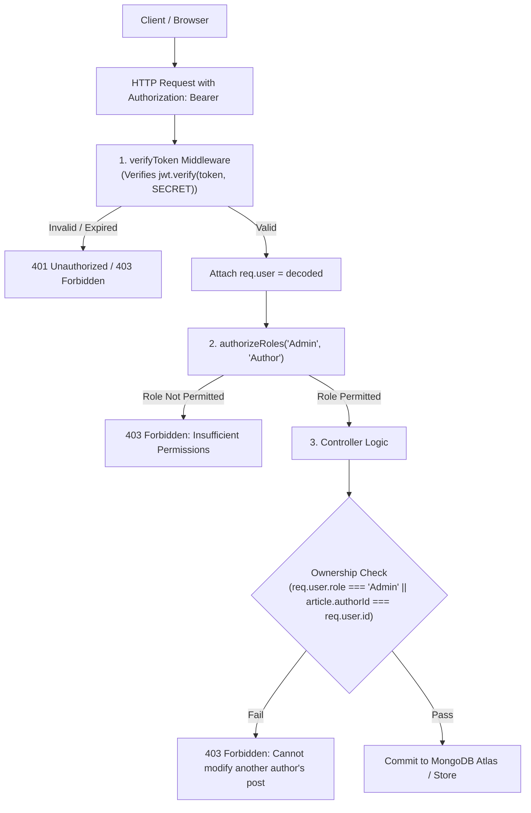

# Practical 11: Blog System with JWT Authentication and Role-Based Access Control (RBAC)

## 📋 Aim
Develop a Blog Management System implementing CRUD operations, stateless **JSON Web Token (JWT)** authentication, and granular **Role-Based Access Control (RBAC)** across `Admin`, `Author`, and `Reader` roles, enforcing resource ownership rules and API authorization guards.

---

## 🎯 Objectives
1. Implement stateless token authentication using **JSON Web Tokens (JWT)** with signing, payload claim validation, and expiration.
2. Build an **Authentication Guard** middleware (`verifyToken`) that inspects the `Authorization: Bearer <token>` header.
3. Design a flexible, higher-order **RBAC Guard** middleware (`authorizeRoles(...)`) restricting endpoints based on user roles.
4. Enforce **Resource Ownership Rules** in controllers, permitting `Author` users to edit and delete only their own articles, while granting `Admin` users global modification privileges.
5. Provide a public feed allowing unauthenticated visitors to read published articles, while requiring authenticated sessions for commenting.
6. Provide an interactive web dashboard for real-time role switching, permissions matrix visualization, and article publishing.

---

## 🛡️ RBAC Permissions Matrix

| Capability / Action | HTTP Method | Endpoint | Guest (Unauthenticated) | Reader | Author | Admin |
| :--- | :--- | :--- | :---: | :---: | :---: | :---: |
| **Read Articles Feed** | `GET` | `/api/articles` | ✅ | ✅ | ✅ | ✅ |
| **Read Article by ID** | `GET` | `/api/articles/:id` | ✅ | ✅ | ✅ | ✅ |
| **Post Comments** | `POST` | `/api/articles/:id/comments` | ❌ | ✅ | ✅ | ✅ |
| **Publish New Article** | `POST` | `/api/articles` | ❌ | ❌ | ✅ | ✅ |
| **Edit Own Article** | `PUT` | `/api/articles/:id` | ❌ | ❌ | ✅ (Owned) | ✅ |
| **Delete Own Article** | `DELETE`| `/api/articles/:id` | ❌ | ❌ | ✅ (Owned) | ✅ |
| **Delete ANY User's Article** | `DELETE`| `/api/articles/:id` | ❌ | ❌ | ❌ | ✅ (Global) |

---

## 🏛️ System Architecture



---

## 🔑 Pre-Seeded Test Credentials

| Role | Email | Password | Scope & Description |
| :--- | :--- | :--- | :--- |
| **Admin** | `admin@blog.io` | `password123` | Global privileges: Create, edit, and delete ANY article. |
| **Author** | `author@blog.io` | `password123` | Publish new articles; edit and delete ONLY their own articles. |
| **Reader** | `reader@blog.io` | `password123` | Read-only access to articles; can post comments. |

---

## 📡 REST API Reference

| Method | Endpoint | Authorization | Description |
| :--- | :--- | :--- | :--- |
| `POST` | `/api/auth/login` | Public | Authenticates credentials and returns signed JWT |
| `GET` | `/api/auth/me` | Bearer Token | Returns current authenticated user and role claims |
| `GET` | `/api/articles` | Public | List articles with search & category filters |
| `GET` | `/api/articles/:id` | Public | Retrieve single article by ID |
| `POST` | `/api/articles` | `Admin`, `Author` | Create and publish a new technical article |
| `PUT` | `/api/articles/:id` | `Admin`, `Author` (Own) | Update an existing article document |
| `DELETE`| `/api/articles/:id` | `Admin`, `Author` (Own) | Delete an article from database |
| `POST` | `/api/articles/:id/comments` | Any Auth User | Post a comment on an article |

---

## 🚀 Setup & Execution

### 1. Install Dependencies
```bash
npm install
```

### 2. Run Server
```bash
npm start
```

### 3. Open Interactive Console
Access **`http://localhost:5006`** in your browser. Use the 1-click Quick Login buttons to switch seamlessly between `Admin`, `Author`, and `Reader` roles.

---

## 🎓 University Viva Voce Q&A

### Q1: What is a JSON Web Token (JWT) and what are its constituent parts?
**Answer:** A JWT is a compact, URL-safe standard (RFC 7519) for transmitting cryptographically verifiable claims between parties. It consists of three parts separated by periods:
1. **Header:** Contains token type (`JWT`) and hashing algorithm (`HS256`).
2. **Payload:** Contains claims such as user ID, role, and expiration timestamp (`exp`).
3. **Signature:** Created by hashing the encoded header and payload with a server-held secret key.

### Q2: How does Role-Based Access Control (RBAC) work in Express.js?
**Answer:** RBAC verifies that an authenticated user possesses the required permissions before accessing a route. In Express, this is achieved via higher-order middleware like `authorizeRoles('Admin', 'Author')`. The middleware inspects `req.user.role` (decoded from the verified JWT) and invokes `next()` if the role matches, or returns `HTTP 403 Forbidden` if permission is denied.

### Q3: Why are JWTs called 'Stateless' and what is their primary advantage?
**Answer:** JWTs are stateless because all authorization data and identity claims are embedded directly within the cryptographic token payload. The backend server does not need to look up a session in a database or Redis cache on every request; it simply validates the digital signature locally, allowing applications to scale horizontally across multiple instances effortlessly.

### Q4: How are JWTs transmitted in HTTP requests?
**Answer:** The standard protocol is to pass the token in the `Authorization` request header using the `Bearer` scheme:
`Authorization: Bearer <jwt_token_string>`
The server parses the header string, strips the `Bearer ` prefix, and verifies the token.

### Q5: What is the difference between Authentication (401) and Authorization (403)?
**Answer:**
- **Authentication (HTTP 401 Unauthorized):** Verifies *who* the client is. It occurs when a request has missing, expired, or invalid credentials.
- **Authorization (HTTP 403 Forbidden):** Verifies *what* the authenticated user is allowed to do. The server knows who you are, but your role lacks the permission required for the specific resource.

### Q6: How is Resource Ownership enforced alongside Role-Based Access Control?
**Answer:** RBAC alone only checks broad roles (e.g., "Is the user an Author?"). Resource Ownership adds fine-grained checks in the controller: `if (user.role !== 'Admin' && article.authorId !== user.id) return res.status(403)`. This guarantees that an Author cannot tamper with or delete another Author's articles.

### Q7: Why must passwords be salted and hashed before storing in MongoDB?
**Answer:** If database records are compromised in plaintext, attacker access is immediate. Salting appends random unique cryptographic bytes to each password, neutralizing rainbow table attacks. Hashing via compute-heavy algorithms like bcrypt ensures brute-force cracking is computationally prohibitive.

### Q8: How can a stateless JWT be revoked prior to its expiration?
**Answer:** Because JWTs are stateless, standard options include:
1. Maintaining a fast in-memory blacklist (e.g. in Redis) for invalidated tokens.
2. Using short-lived access tokens (e.g. 10 minutes) accompanied by revocable refresh tokens stored in the database.
3. Storing a `tokenVersion` integer in the user database record that increments upon logout, invalidating previously issued tokens.
