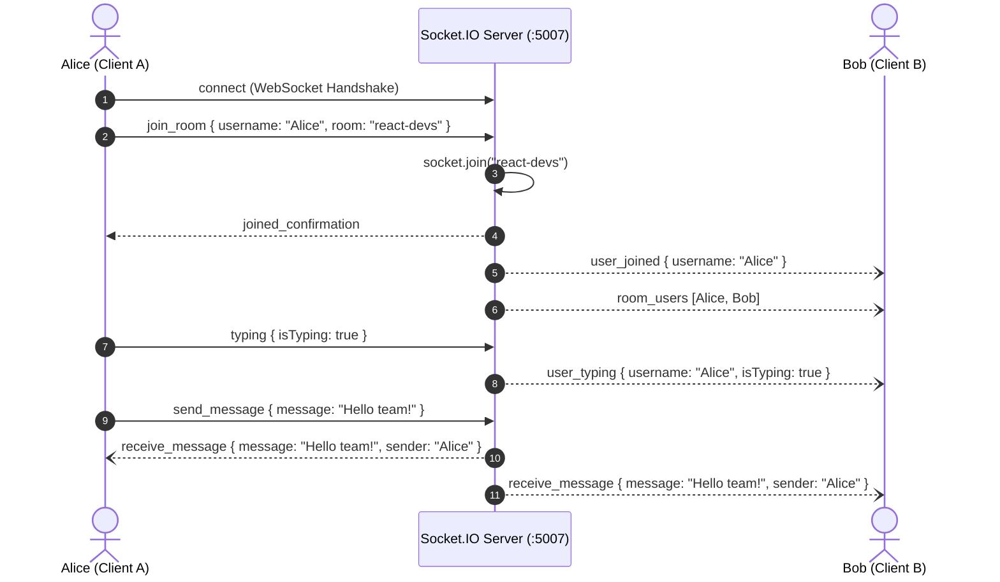

# Practical 12: Real-Time Chat Application using Socket.IO, React and Node.js

## 📋 Aim
Develop a Real-Time Multi-Room Chat Application utilizing **Socket.IO**, **React 19**, and **Node.js**, implementing bidirectional full-duplex communication, channel switching, live typing indicators, active participant rosters, and system notifications without HTTP polling.

---

## 🎯 Objectives
1. Understand the core differences between traditional HTTP request-response cycles and full-duplex persistent **WebSocket / Socket.IO** transport.
2. Configure a **Socket.IO** server atop an HTTP server with Cross-Origin Resource Sharing (CORS) rules.
3. Implement **Channel Partitioning (Rooms)** using `socket.join(room)` and `socket.leave(room)` to isolate conversations.
4. Establish custom event contracts (`send_message`, `receive_message`, `typing`, `user_joined`, `user_left`).
5. Build an interactive React frontend maintaining live connection state, dynamic roster synchronization, and auto-scrolling message streams.
6. Mitigate network chattiness via client-side debouncing for typing indicators.

---

## 🏛️ Socket.IO Event Architecture



---

## 📡 Socket.IO Event Dictionary

| Event Name | Direction | Payload | Description |
| :--- | :--- | :--- | :--- |
| `join_room` | Client ➔ Server | `{ username, room }` | Subscribes socket to target room channel |
| `joined_confirmation` | Server ➔ Client | `{ room, users, message }` | Acknowledges successful room subscription |
| `send_message` | Client ➔ Server | `{ room, message, username }` | Transmits chat message payload |
| `receive_message` | Server ➔ Room | `{ id, room, username, message, timestamp }` | Broadcasts message to all room members |
| `typing` | Client ➔ Server | `{ room, username, isTyping }` | Signals keystroke activity |
| `user_typing` | Server ➔ Peers | `{ username, isTyping }` | Broadcasts typing indicator to peers |
| `user_joined` | Server ➔ Room | `{ username, message, timestamp }` | Announces new participant entrance |
| `user_left` | Server ➔ Room | `{ username, message, timestamp }` | Announces participant departure |
| `room_users` | Server ➔ Room | `[{ socketId, username, joinedAt }]` | Synchronizes active online user roster |

---

## 📁 Repository Structure

```
Practical-12-SocketIO-Chat-App/
├── package.json               # Root scripts
├── server/                    # Socket.IO & Express Backend (Port 5007)
│   ├── package.json
│   └── server.js              # HTTP server, socket room handlers, disconnect lifecycle
└── client/                    # React 19 + Socket.IO Client Frontend (Port 5178)
    ├── package.json
    ├── vite.config.js         # WebSocket and HTTP proxy to :5007
    ├── index.html
    └── src/
        ├── main.jsx           # ReactDOM entry point
        ├── App.jsx            # Socket connection lifecycle & state orchestration
        ├── index.css          # Glassmorphic vanilla CSS design system
        └── components/
            ├── UserList.jsx   # Rooms list & online roster
            ├── ChatRoom.jsx   # Message feed & typing indicator
            └── VivaSection.jsx # 8 viva voce Q&As
```

---

## 🚀 Setup & Execution

### 1. Launch Socket.IO Backend Server (Port 5007)
Open a terminal in the practical directory:
```bash
cd server
npm install
npm start
```

### 2. Launch React Frontend (Port 5178)
In a second terminal:
```bash
cd client
npm install
npm run dev
```

Open **`http://localhost:5178`** in two separate browser windows (or Incognito mode) to test real-time multi-user chat, room switching, and live typing indicators.

---

## 🎓 University Viva Voce Q&A

### Q1: What is Socket.IO and how does it differ from HTTP REST?
**Answer:** HTTP is a unidirectional, stateless protocol where clients must initiate every transaction. Socket.IO is a library built on top of the WebSocket protocol enabling persistent, low-latency, bidirectional, and event-driven communication between web browsers and Node.js servers without the overhead of HTTP headers on each message.

### Q2: What is the Engine.IO fallback mechanism in Socket.IO?
**Answer:** Socket.IO initially connects via HTTP Long-Polling through its transport engine (Engine.IO). Once the HTTP handshake succeeds, it attempts an automatic transport upgrade to full duplex WebSockets. If a network firewall or proxy forbids WebSockets, Socket.IO continues operating seamlessly via long-polling.

### Q3: What are Socket.IO Rooms?
**Answer:** Rooms are server-side channels that sockets can join (`socket.join(room)`) and leave (`socket.leave(room)`). They permit targeted event broadcasting—such as `io.to(room).emit('receive_message', ...)`—exclusively to users in that channel, without broadcasting across all connected clients.

### Q4: Compare `socket.emit()`, `socket.to(room).emit()`, and `io.to(room).emit()`.
**Answer:**
- `socket.emit()`: Emits the event *only* to the single client associated with that socket.
- `socket.to(room).emit()`: Emits to *all other clients* in the room *except* the sender (used for typing indicators and join alerts).
- `io.to(room).emit()`: Broadcasts to *every client* in the room, *including* the sender.

### Q5: How are Typing Indicators implemented efficiently?
**Answer:** The client emits a `typing` event upon input changes and sets a debounce timer (e.g., 1500ms). If no further keystrokes occur before the timer expires, a `typing: false` event is emitted. The server relays this state to peers via `socket.to(room).emit('user_typing', ...)`.

### Q6: How does Socket.IO handle unexpected client disconnections?
**Answer:** Socket.IO continuously sends periodic heartbeat pings. If a ping timeout occurs (due to network failure or closed browser tab), the server triggers the `disconnect` event. In our server, the user is removed from active rosters and a `user_left` announcement is broadcast to the room.

### Q7: How do you scale Socket.IO across multiple server nodes?
**Answer:** Because WebSockets maintain persistent TCP connections bound to a single server process, horizontal scaling requires an external publish/subscribe message broker like the **Socket.IO Redis Adapter**. When an event is emitted on Server A, Redis fans out the packet to Servers B and C so connected clients on other nodes receive the message.

### Q8: Why must Socket.IO event listeners be cleaned up in React `useEffect`?
**Answer:** If socket event listeners registered with `socket.on(...)` are not removed in the `useEffect` cleanup return callback (`socket.off(...)`), new duplicate listeners are registered on each component re-render, leading to severe memory leaks and duplicate message triggers.
