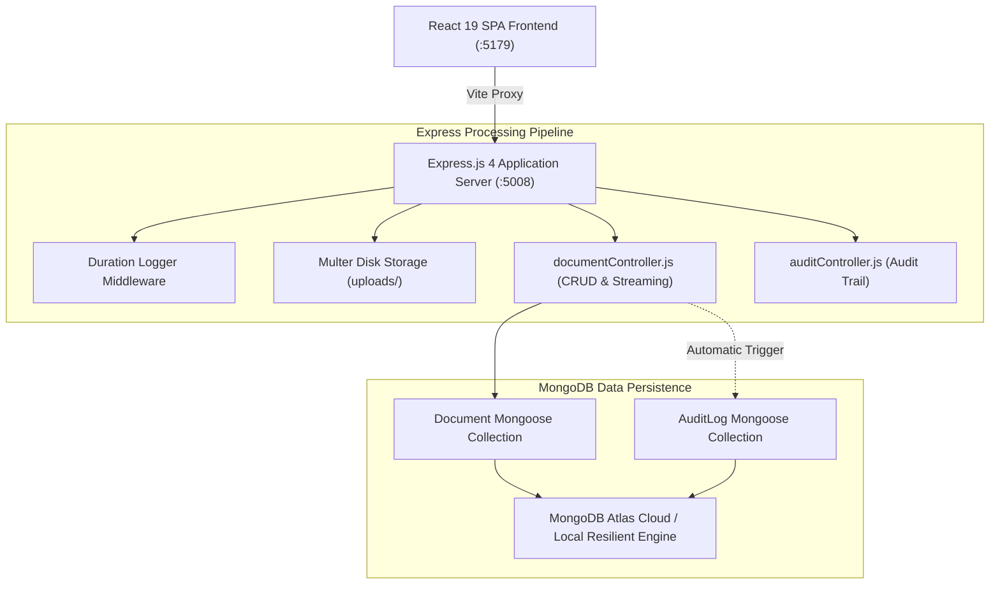

# Practical 13: Full-Stack MERN Mini Project — CloudDocs DMS

## 🏆 Project Title
**CloudDocs DMS: Enterprise Document Management & Compliance Archival Platform**

---

## 📋 Aim
Design, develop, and deploy an industry-oriented, full-stack **MERN** (MongoDB Atlas, Express.js, React 19, Node.js) enterprise web application for Document Archival, Multi-Tier Security Classification, Versioning, and Compliance Audit Logging, integrating Multer file ingestion, full-text search, and automated audit trails.

---

## 🎯 Objectives
1. Architect an end-to-end full-stack enterprise web application combining all skills acquired across Practicals 01 through 12.
2. Implement **Multipart File Streaming** using Multer to handle heterogeneous document formats (PDF, DOCX, XLSX, TXT, PNG, JPEG) up to 10 MB with unique cryptographic naming.
3. Establish a **Multi-Tier Security Classification System** (`Public`, `Internal`, `Confidential`, `Restricted`) enforcing access boundaries.
4. Model typed data structures in MongoDB via Mongoose for documents and immutable compliance records.
5. Implement an automated **Audit Trail Subsystem** logging every upload, download, metadata modification, and purge event.
6. Provide an interactive React 19 Single Page Application with dynamic category filtering, search debounce, tabbed view navigation, and live storage statistics.

---

## 🏛️ System Architecture



---

## 🗄️ Database Entity Schema Specifications

### 1. Document Collection
```javascript
const documentSchema = new mongoose.Schema(
  {
    docId:                  { type: String, required: true, unique: true },
    title:                  { type: String, required: true, trim: true },
    description:            { type: String, trim: true },
    category:               { type: String, enum: ['Technical', 'Legal', 'Financial', 'HR', 'Engineering', 'Architecture'] },
    securityClassification: { type: String, enum: ['Public', 'Internal', 'Confidential', 'Restricted'] },
    version:                { type: String, default: 'v1.0' },
    filename:               { type: String, required: true },
    originalName:           { type: String, required: true },
    path:                   { type: String, required: true },
    mimetype:               { type: String, required: true },
    size:                   { type: Number, required: true },
    author:                 { type: String, required: true },
    department:             { type: String, required: true },
    downloadCount:          { type: Number, default: 0 },
    isArchived:             { type: Boolean, default: false }
  },
  { timestamps: true }
);
```

### 2. AuditLog Collection (Immutable Compliance Trail)
```javascript
const auditLogSchema = new mongoose.Schema(
  {
    action:      { type: String, enum: ['UPLOAD', 'DOWNLOAD', 'UPDATE', 'DELETE', 'VIEW_METADATA'] },
    docId:       { type: String, required: true },
    docTitle:    { type: String, required: true },
    performedBy: { type: String, default: 'Admin Compliance Officer' },
    role:        { type: String, default: 'Administrator' },
    ipAddress:   { type: String, default: '127.0.0.1' },
    details:     { type: String, required: true }
  },
  { timestamps: true }
);
```

---

## 📡 REST API Reference

| Method | Endpoint | Description | Request Body / Query |
| :--- | :--- | :--- | :--- |
| `GET` | `/api/documents` | Retrieve documents with filters & search | `?search=`, `?category=`, `?classification=`, `?sort=` |
| `POST` | `/api/documents/upload` | Ingest new document file and metadata | `multipart/form-data` (`file`, `title`, `category`, `classification`, etc.) |
| `GET` | `/api/documents/:id/download` | Download attachment file & increment count | Streams binary with `Content-Disposition: attachment` |
| `PUT` | `/api/documents/:id` | Update metadata & promote version | JSON Body with revised attributes |
| `DELETE`| `/api/documents/:id` | Purge document from disk and database | URL parameter `:id` |
| `GET` | `/api/documents/audit-logs` | Fetch chronologically sorted audit trail | Returns historical compliance entries |
| `GET` | `/api/documents/analytics/overview` | Aggregated storage and category stats | Storage in MB, classification breakdown |
| `GET` | `/api/health` | Inspect cluster and server status | Returns MongoDB Atlas / fallback state |

---

## 🚀 Setup & Execution

### 1. Launch Backend Server (Port 5008)
```bash
cd server
npm install
npm start
```

### 2. Launch React Frontend (Port 5179)
```bash
cd client
npm install
npm run dev
```

Open **`http://localhost:5179`** in your browser. All requests are reverse-proxied to `http://localhost:5008`.

---

## 🎓 University Viva Voce Q&A

### Q1: What is the core business problem addressed by CloudDocs DMS?
**Answer:** In enterprise workflows, unmanaged document distribution leads to version collisions, accidental leaks of confidential legal and financial documents, and non-compliance with standards like SOC2 and ISO 27001. CloudDocs DMS provides structured ingestion with cryptographic unique file naming, multi-tier security classifications, version tracking, and an immutable audit trail capturing every interaction.

### Q2: How does CloudDocs DMS combine Multer and MongoDB without database bloat?
**Answer:** Storing binary files directly in MongoDB causes document bloat and violates the 16MB BSON size limit. CloudDocs DMS uses Multer disk storage to stream the physical binary file to server disk (or S3 buckets), and persists only lightweight, typed, and indexed metadata in MongoDB, enabling sub-millisecond search and retrieval.

### Q3: Why is the AuditLog collection designed to be immutable?
**Answer:** Compliance frameworks require non-repudiation: proving who uploaded, downloaded, or modified sensitive files. The API intentionally exposes only `GET` and internal append operations for audit logs, omitting `PUT` and `DELETE` endpoints to ensure records remain tamper-proof.

### Q4: How are file overwrite collisions prevented?
**Answer:** Files are never saved under their user-submitted names. Multer sanitizes the filename and appends a timestamp and cryptographic random hex string (`crypto.randomBytes(6).toString('hex')`), ensuring that two users uploading files with the same name never overwrite each other.

### Q5: How does the backend stream files securely?
**Answer:** The frontend does not expose static public URLs directly. Instead, clicking "Download" invokes `/api/documents/:id/download`. The Express controller verifies document presence, increments `downloadCount`, logs a `DOWNLOAD` action in the audit trail, and calls `res.download(filePath, originalName)` setting `Content-Disposition: attachment`.

### Q6: What operations are performed in the DMS Analytics Aggregation Pipeline?
**Answer:** The aggregation pipeline groups documents to calculate total storage consumed (`$sum: "$size"`), count documents per business domain (`$group: { _id: "$category", count: { $sum: 1 } }`), and categorize records across security tiers to deliver real-time metrics to the React dashboard.

### Q7: How does React 19 manage state synchronization with the Express backend?
**Answer:** Functional React components use `useEffect` and `useCallback` hooks. When a document is uploaded, updated, or purged, the client triggers synchronized state updates across the document feed, analytics banner, and audit log drawer without requiring a full page refresh.

### Q8: What production enhancements would prepare this system for millions of concurrent users?
**Answer:**
1. **Cloud Object Storage:** Transition disk storage to Amazon S3 or Cloudflare R2 using pre-signed upload/download URLs.
2. **Full-Text Content Search:** Implement MongoDB Atlas Search or Elasticsearch to index text *inside* uploaded PDF and Word documents.
3. **Envelope Encryption:** Encrypt files at rest with AES-256 using keys managed by AWS KMS.
4. **Microservices:** Decouple the file ingestion worker from metadata querying using message queues like RabbitMQ or Apache Kafka.
